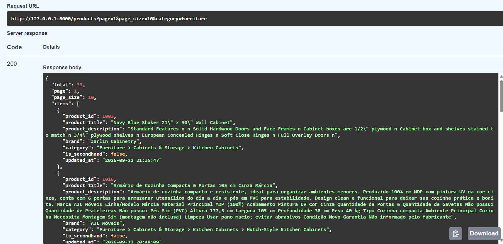
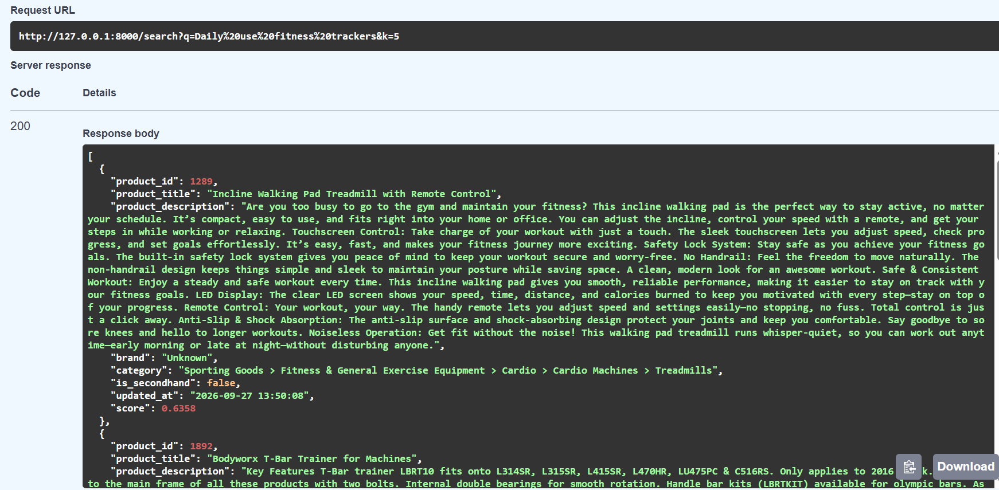
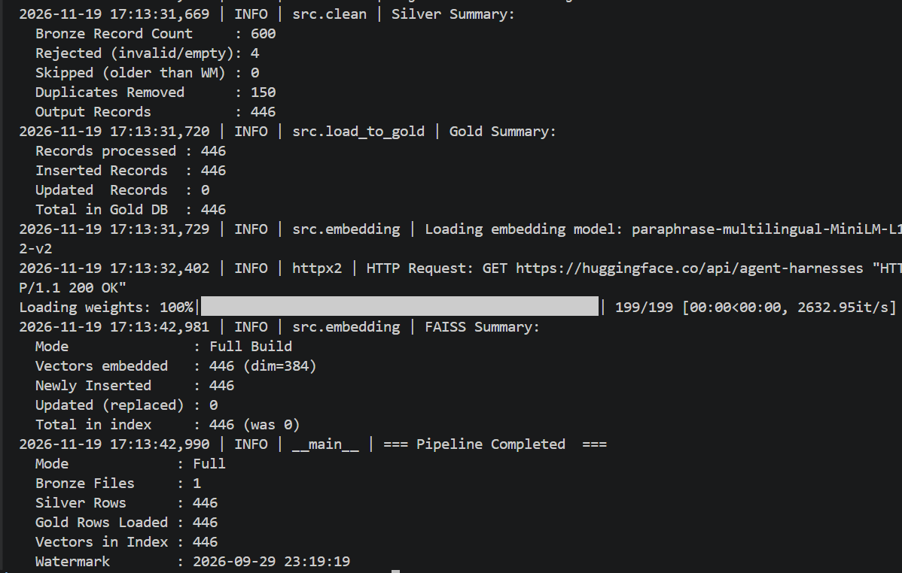
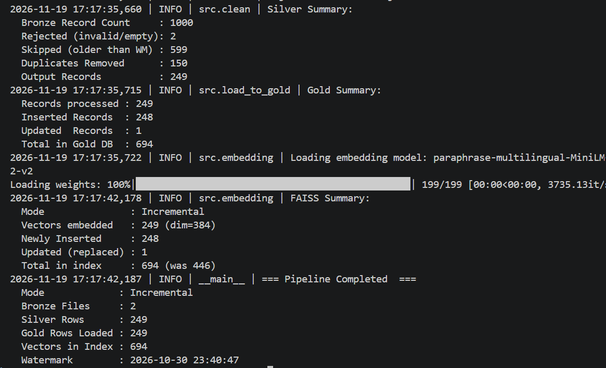

# AI-Powered Product Data Pipeline & Semantic Search

An end to end data engineering project that ingests product data, applies incremental ETL processing, stores validated records in SQLite, and enables natural language product search using Sentence Transformers and FAISS.

## Overview

The pipeline follows a Medallion-style architecture:

- **Bronze:** Ingests CSV batches and adds source file and ingestion time metadata.
- **Silver:** Cleans and validates records, handles missing values, removes duplicates, and filters records using an update watermark.
- **Gold:** Loads product records into SQLite using product IDs for inserts and updates.
- **Search:** Generates 384 dimensional text embeddings and indexes them in FAISS for semantic similarity search.

The sample data is 990 products from Shopify's product catalogue, split into three batches. The batches also contain duplicates, stale records, updated products and missing values on purpose, so the cleaning and incremental logic have real work to do.

## Architecture

```
data/raw_batches/*.csv
        |  ingest
        v
Bronze   data/bronze/      raw files, copied as they arrived
        |  clean
        v
Silver   data/silver/      cleaned rows, one per product (plus rejected.csv)
        |  load_to_gold, embedding
        v
Gold     data/gold/products.db      product details (SQLite)
         data/gold/faiss.index   embeddings (FAISS)

Search:  query -> embedding -> FAISS (closest product_ids) -> SQLite (full details) -> JSON
```

## How it works

**Cleaning (Silver).** Text is repaired (some of the source text was garbled by a wrong character encoding), HTML tags are stripped, and whitespace is normalised. Product IDs and timestamps are validated. Records with neither a title nor a description are not silently dropped; they are written to `data/silver/rejected.csv` with a reason. For duplicate product IDs, the record with the newest `updated_at` is kept. Missing values stay NULL. Placeholders such as "Unknown" appear only when the API returns a product, so the stored data never contains invented values.

**Loading (Gold).** Records are upserted into SQLite by `product_id`: new products are inserted and changed products are updated. For each product, a `search_text` is built from its title, category, brand and description (skipping anything missing), and this is the text that gets embedded.

**Search.** The query is embedded with the same model, FAISS returns the closest `product_id`s, and SQLite returns the full details for those IDs. The `product_id` links the two.

**Incremental loading.** The pipeline stores a watermark, which is the newest `updated_at` processed so far. Every run adds a row to the `pipeline_state` table, so it also works as a run history, and the watermark is the largest value in it.

- With no FAISS index or no watermark, the run is a full load.
- Otherwise only records with `updated_at` at or after the watermark are processed. Older records, including stale copies of a product, are skipped. 
- Only the changed products are re embedded, and their old vectors are replaced in FAISS.
- The watermark is saved last, after Silver, SQLite and FAISS have all finished, so a failed run is simply retried.
- If the FAISS index file is deleted, the next run notices and rebuilds it from SQLite.

## Data Source

Sample derived from Shopify's The Catalogue product dataset on Hugging Face (Apache 2.0 license). The images were removed and a sample of the products was used. The source has no update timestamp, so updated_at is simulated across three batches to demonstrate incremental loading.

## Tech Stack

- **Language and processing:** Python, Pandas
- **Database:** SQLite
- **Embeddings:** Sentence Transformers (`paraphrase-multilingual-MiniLM-L12-v2`)
- **Vector search:** FAISS
- **API:** FastAPI, Uvicorn
- **Dataset:** Hugging Face Datasets
- **Text cleaning:** ftfy
- **Tests:** pytest

## Project Structure

```text
Product_Search_POC/
├── main.py
├── prepare_data.py
├── run_pipeline.py
├── requirements.txt
├── src/
│   ├── config.py
│   ├── ingest.py
│   ├── clean.py
│   ├── db.py
│   ├── load_to_gold.py
│   ├── embedding.py
│   └── search.py
├── data/
│   ├── raw_batches/
│   ├── bronze/
│   ├── silver/
│   └── gold/
│       ├── products.db
│       └── faiss.index
│── tests/
│   └── test_pipeline.py
│     
└── screenshots/
    ├── product_list.png
    ├── semantic_search.png
    ├── initial_load.png
    └── incremental_run.png     
```

## Setup and Execution

### 1. Clone the repository

```bash
git clone https://github.com/dilma1/product-data-pipeline-semantic-search.git
cd product-data-pipeline-semantic-search
```

### 2. Create and activate a virtual environment

```bash
python -m venv venv
```

**Windows**
```bash
venv\Scripts\activate
```

### 3. Install dependencies

```bash
pip install -r requirements.txt
```

### 4. Sample data

The three sample batches are already in data/raw_batches/. prepare_data.py is optional: it recreates them from Hugging Face and overwrites these files.

### 5. Run the pipeline

To see incremental loading, keep only batch_1.csv in data/raw_batches/ (move the other two out) and run:

```bash
python run_pipeline.py
```

Then copy batch_2.csv back and run it again, and repeat with batch_3.csv. The first run is a full load. The next two are incremental and process only new or changed records. The embedding model is downloaded on first use if it is not already cached.

### 6. Start the API

```bash
uvicorn main:app --reload
```

Open the interactive API documentation at `http://127.0.0.1:8000/docs` and use `POST /process` to execute the complete pipeline.

### 7. Run the tests

```bash
python -m pytest -q
```
This runs one end-to-end test on two small batches, using fake embeddings so it works offline.

## API Endpoints

| Method | Endpoint | Description |
|---|---|---|
| `GET` | `/health` | Returns pipeline and index status |
| `POST` | `/ingest` | Ingests CSV files into Bronze |
| `POST` | `/process` | Runs the complete pipeline |
| `GET` | `/products` | Returns paginated products with filters |
| `GET` | `/search` | Performs semantic product search |

/products accepts page, page_size (up to 100), category, secondhand, date_from and date_to (the date filters apply to updated_at, format YYYY-MM-DD).

/search accepts q (the query), k (number of results, default 5, up to 50), category and secondhand. Results are ordered from best to worst match, and each one includes a score (higher means closer).

## Product Listing 

Retrieve products with pagination and category filtering.

Example request:
```http
GET /products?page=1&page_size=10&category=furniture
```


## Semantic Search

Search for products using natural-language queries instead of relying only on exact keyword matching.

Example request:
```http
GET /search?q=Daily%20use%20fitness%20trackers&k=5
```


## Pipeline Execution Results
The pipeline supports both initial full loading and watermark based incremental processing.

Initial Load: Processes the first batch, performs data cleaning and deduplication, loads validated records into SQLite, and builds the FAISS index.

Incremental Load: Processes subsequent data using a watermark, skips older records, inserts new products, and updates existing records and their embeddings.

### 1. Initial Full Load



### 2. Incremental Load




